# Administrador con Django

Laboratorio LAB05-DJANGO para Windows. Proyecto de Django con configuración en
`config` y una aplicación `movies`, responsable del catálogo, las valoraciones,
el administrador y las recomendaciones públicas.

## Requisitos

- Python 3.12 o superior. El laboratorio se verificó con Python 3.14.
- Django 6.1.1 y Pillow 12.3.0, con dependencias fijadas en `requirements.txt`.
- PowerShell y Git.

## Instalación

Ejecuta estos comandos en PowerShell. El entorno virtual ya está creado en la
entrega; el primer comando de Python permite recrearlo en una instalación nueva.
Si utilizas Python 3.12 o 3.13, sustituye `-3.14` por la versión instalada.

```powershell
Set-Location -LiteralPath "$env:USERPROFILE\Desktop\LAB05-DJANGO"
py -3.14 -m venv venv
.\venv\Scripts\python.exe -m pip install -r requirements.txt
$env:SECRET_KEY = & .\venv\Scripts\python.exe -c "import secrets; print(secrets.token_urlsafe(64))"
$env:DEBUG = "1"
$env:ALLOWED_HOSTS = "localhost,127.0.0.1"
.\venv\Scripts\python.exe manage.py migrate
.\venv\Scripts\python.exe manage.py check
```

No es necesario activar el entorno ni cambiar la política de ejecución de
PowerShell: todos los comandos usan directamente su ejecutable de Python.
`SECRET_KEY` es obligatoria y no tiene un valor por defecto en el código. Las
variables se mantienen solo en la sesión de PowerShell; configúralas de nuevo al
abrir otra terminal. Para conservar sesiones entre reinicios, proporciona la
misma clave mediante el entorno, sin escribirla en archivos del proyecto.

`DEBUG` está desactivado por defecto. Actívalo únicamente para desarrollo local.
La base SQLite es local y no necesita credenciales. No se versionan el entorno,
la base de datos, los archivos subidos ni las claves. Las migraciones sí se
versionan.

### Superusuario

El superusuario solicitado ya existe en la base local de esta entrega. En una
base nueva, créalo de forma interactiva; Django pide el usuario y la contraseña
sin guardar la contraseña en archivos del proyecto:

```powershell
.\venv\Scripts\python.exe manage.py createsuperuser
```

Las claves de cuentas se almacenan únicamente como hashes en la base de datos.
No uses claves débiles ni este servidor de desarrollo para producción.

## Levantar el proyecto

Con las variables anteriores configuradas:

```powershell
.\venv\Scripts\python.exe manage.py runserver 127.0.0.1:8000
```

Abre `http://127.0.0.1:8000/admin/` para el panel. Detén el servidor con
`Ctrl+C` antes de iniciar otro en el mismo puerto. La raíz `/` redirige al
catálogo público en `/movies/`.

No hay fixtures ni seeds que carguen el catálogo. Añade géneros,
personas, películas y valoraciones manualmente desde el administrador. El
formulario de película incluye una fila adicional de valoración y campos de
auditoría de solo lectura. Los puntajes admitidos son enteros del 1 al 10.

Los pósters se guardan bajo `media/posters/`. Django crea esa carpeta al subir
el primer archivo. `MEDIA_ROOT` apunta a `media` y `MEDIA_URL` es `/media/`.
Los archivos se sirven por Django únicamente con `DEBUG=1`.

## Crear editores

El comando se ejecutó sobre la base local del laboratorio para crear el grupo
`editores` y un usuario de prueba. En una base nueva hay que ejecutarlo otra vez.
Ejecuta `migrate` antes de utilizarlo. Sustituye los argumentos por los tuyos:

```powershell
.\venv\Scripts\python.exe manage.py setup_editors --username "TU_USUARIO" --password "TU_CLAVE_SEGURA"
```

Los dos argumentos son obligatorios y no tienen valores por defecto. La clave
se valida con los validadores de Django y se guarda como hash. El resumen
indica si se crearon o actualizaron el grupo y el usuario, sin imprimir la clave.

Para no escribir una clave literal en el historial de PowerShell, puedes pedirla
de forma oculta y pasarla igualmente mediante el argumento requerido:

```powershell
$editorUsername = Read-Host "Usuario del editor"
$editorPassword = Read-Host "Clave del editor" -AsSecureString
$editorPlain = [System.Net.NetworkCredential]::new("", $editorPassword).Password
.\venv\Scripts\python.exe manage.py setup_editors --username $editorUsername --password $editorPlain
Remove-Variable -Name editorPassword, editorPlain
```

Aunque la entrada sea oculta, el argumento de contraseña podría ser visible
para procesos con permisos suficientes en la máquina. Utilízalo localmente.

El comando es transaccional y puede ejecutarse dos veces: reutiliza el grupo y
el usuario mediante `get_or_create`, fija los seis permisos del grupo y
actualiza la clave del usuario indicado. Rechaza una cuenta superusuaria para
no rebajar sus privilegios. Si falla la validación, revierte los cambios.

## Roles y permisos

Se aplica el principio de mínimo privilegio: el superusuario administra el
sistema completo y el editor trabaja con el catálogo sin permisos destructivos
ni capacidad de administrar identidades.

| Rol | Responsabilidades y límites |
| --- | --- |
| Superusuario | Administra los cuatro modelos y puede crear, editar y eliminar datos. Gestiona usuarios, grupos y permisos. Prepara géneros y personas para el catálogo. |
| Editor | Tiene `is_staff=True` para entrar al panel e `is_superuser=False`. Pertenece al grupo `editores`; puede ver, añadir y modificar películas y valoraciones. No puede eliminar películas ni valoraciones, ni acceder a Usuarios o Grupos. |

El grupo `editores` recibe exactamente estos permisos de la aplicación `movies`:

- `add_movie`, `change_movie` y `view_movie`.
- `add_rating`, `change_rating` y `view_rating`.

`view_movie` permite abrir el listado. Los permisos sobre valoraciones permiten
usar el inline en el formulario de película. No se conceden `delete_movie`,
`delete_rating` ni permisos de `auth`. El editor selecciona géneros y directores
existentes, pero no puede administrar los modelos Genre y Person.

El administrador de Django oculta las acciones y botones de eliminación y
rechaza también los intentos directos por URL; no depende solo de esconder
controles en la interfaz. Usuarios y Grupos quedan reservados al superusuario
para evitar que un editor se asigne privilegios adicionales.

Utiliza una cuenta dedicada para el editor. Si el usuario ya existía, el comando
conserva sus otros grupos y permisos directos: Django acumula esos permisos y
podrían ampliar el acceso. El superusuario debe revisar esas asignaciones.

## Catálogo y búsqueda

La ruta `/movies/` muestra el catálogo público: un banner con las películas
mejor valoradas y filas por valoración, año y género, con el póster de cada
película cuando existe. La barra de búsqueda filtra por título, director o
género mediante el parámetro `q`, por ejemplo `/movies/?q=drama`. Cada tarjeta
enlaza con las recomendaciones de esa película.

## Recomendaciones

Después de cargar datos manualmente, abre la ruta usando el identificador de
una película existente:

```text
http://127.0.0.1:8000/movies/<pk>/recommendations/
```

La vista es pública, devuelve 404 si la película no existe y selecciona hasta
cinco películas que comparten al menos un género. Excluye la película
consultada y las candidatas sin valoraciones. Calcula el promedio con `Avg`,
ordena de mayor a menor y desempata por título e identificador. Una película
que comparte varios géneros aparece una sola vez. El template muestra título,
año y promedio sobre 10, o un mensaje si no hay resultados.

## Tests

Configura `SECRET_KEY` en la sesión y ejecuta:

```powershell
.\venv\Scripts\python.exe manage.py test movies.tests --verbosity 2
```

Los 33 tests usan `django.test` y una base temporal en memoria, que Django
destruye al finalizar. Los tests generan sus propios datos y llaman a
`setup_editors` solo en esa base temporal; no modifican `db.sqlite3`.

Se comprueban los permisos exactos del grupo, la idempotencia y validación del
comando, la protección del superusuario, el acceso al listado, el bloqueo de
eliminaciones y de Usuarios/Grupos, el inline y los campos de solo lectura.
También se prueban los promedios, el orden, la exclusión de la película
consultada, el límite de cinco, la ausencia de duplicados y el 404. Del
catálogo se prueban la redirección desde la raíz, el promedio por película y
la búsqueda por título, director y género.

## Historial

Cada paso del 1 al 10 tiene su propio commit. Los tests y este README tienen
commits separados. Una corrección de formato PEP 8 se conserva en otro commit
independiente. No se hizo push.

El panel sin personalizar corresponde a `5754586` y contiene únicamente los
cuatro registros con `admin.site.register` en `movies/admin.py`. La captura
del estado anterior se tomó antes de continuar con la personalización.

```powershell
git log --oneline
git show 5754586:movies/admin.py
```

## Capturas

Las imágenes están en la carpeta `capturas/`.

### panel antes de personalizar

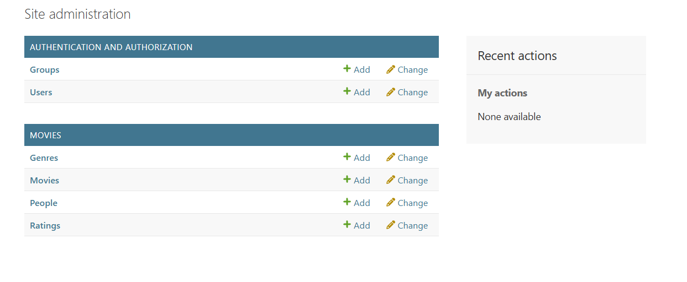
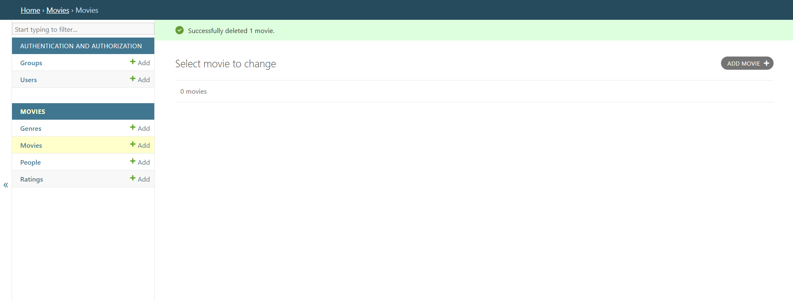

### panel después

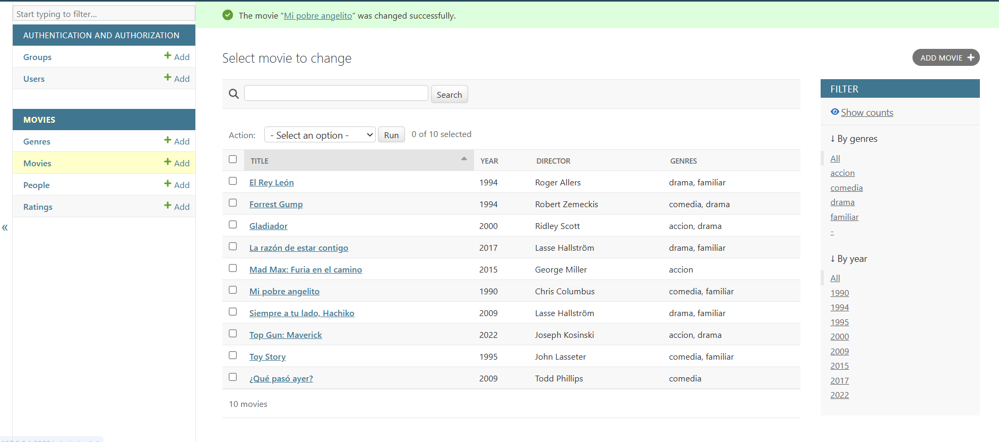
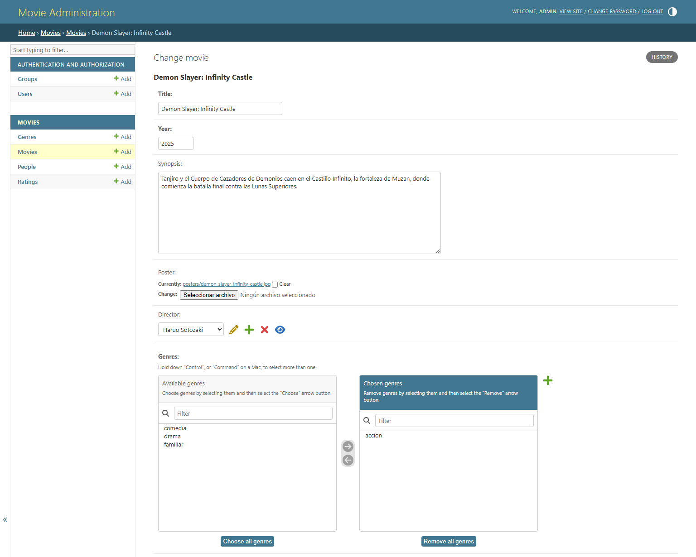
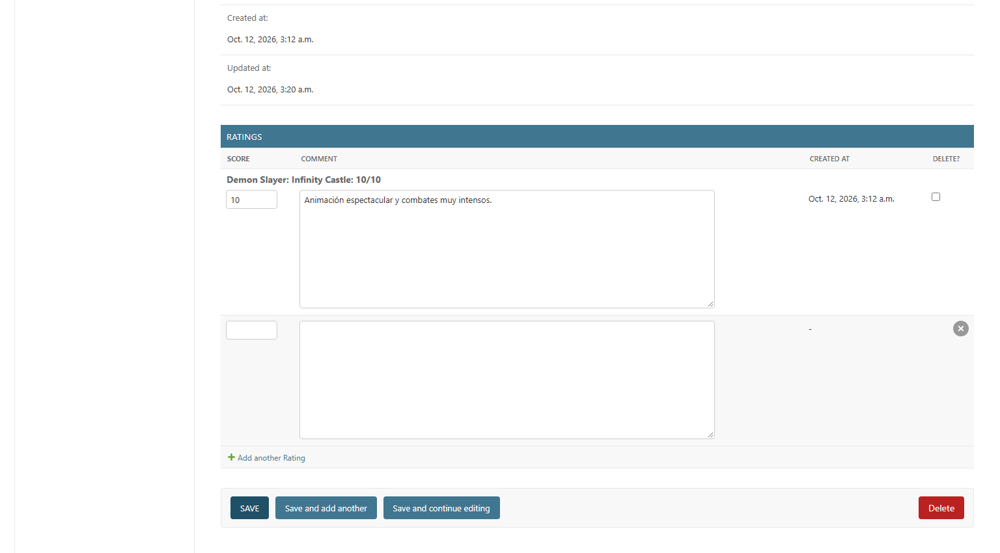

### vista del superusuario

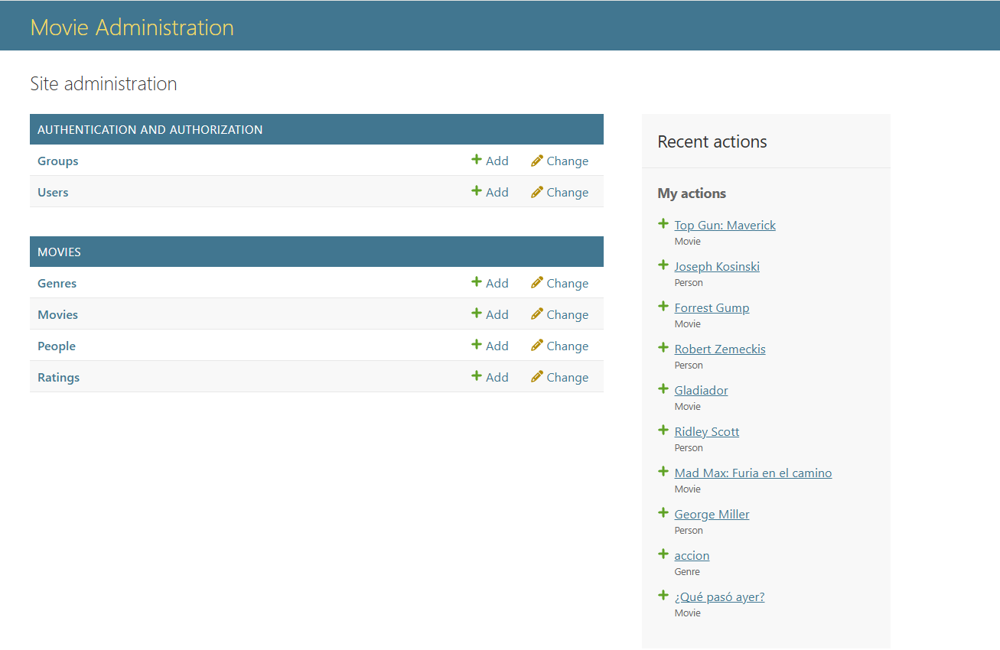
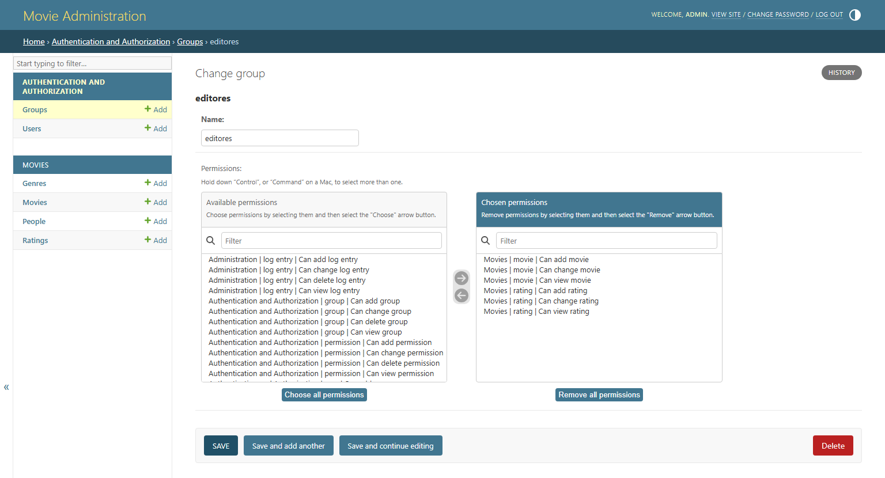

### vista del editor

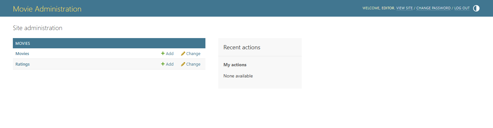
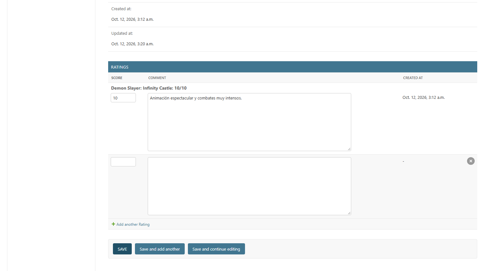

### catálogo público y pruebas

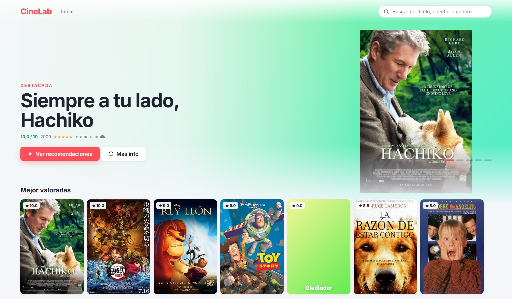
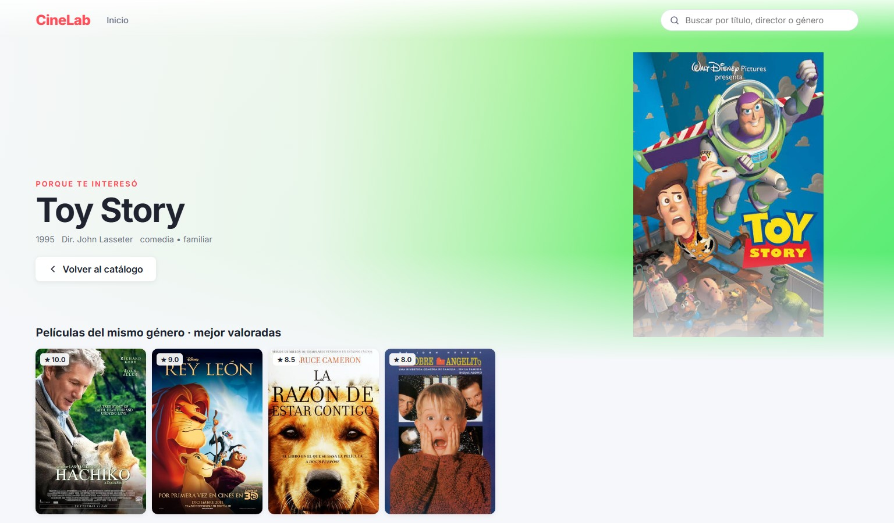
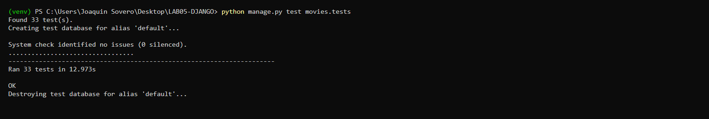
